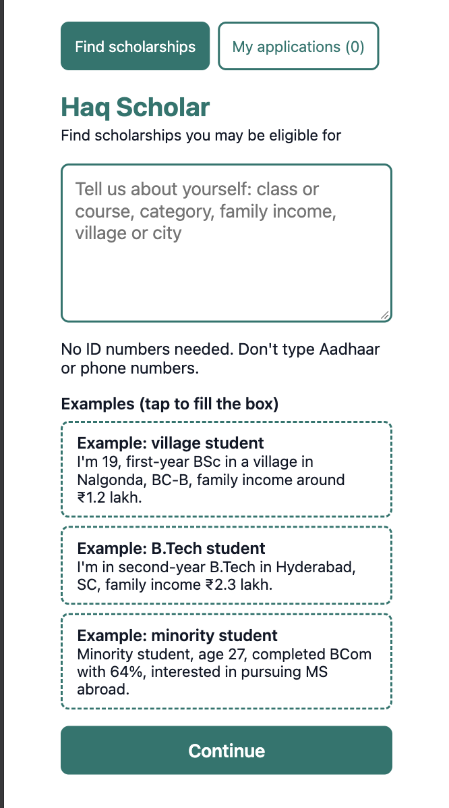
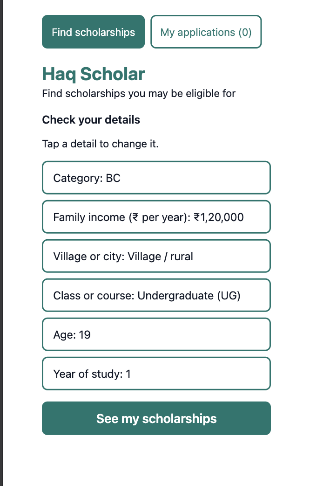
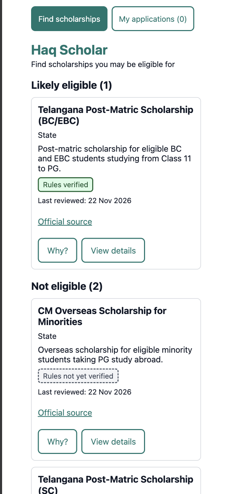
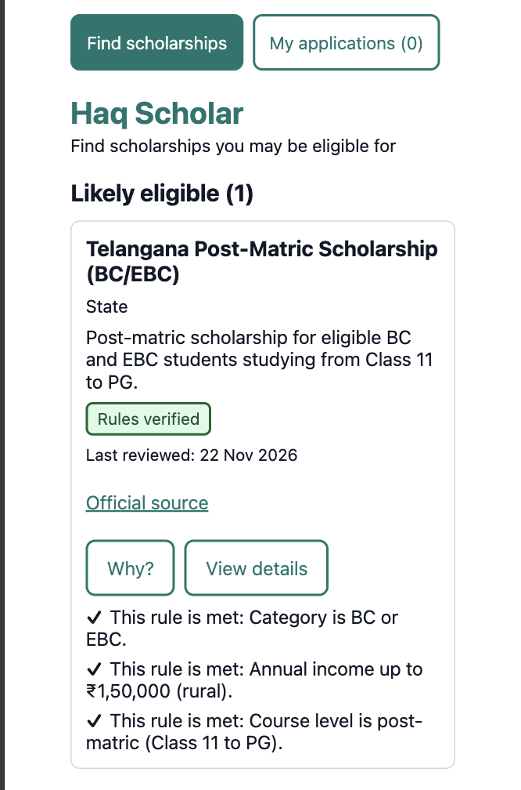
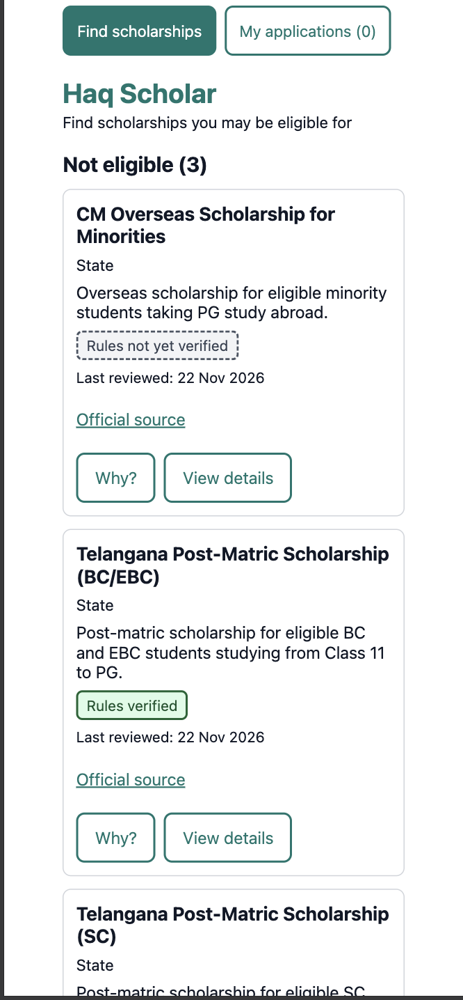
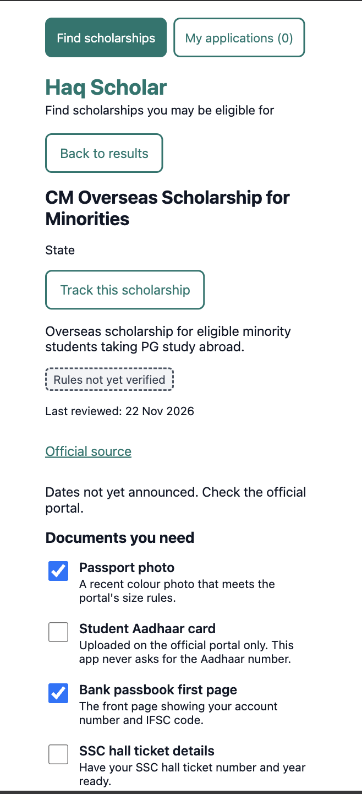
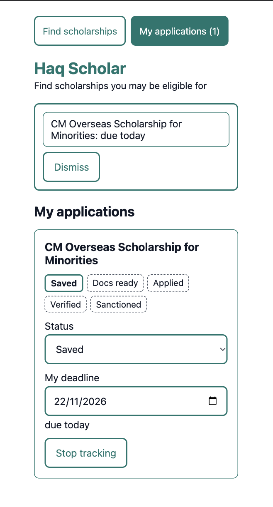

# Haq Scholar

**Find the scholarships you are likely eligible for, in plain language.**

**Live app:** https://scheme-navigator-lipe.onrender.com
*(Free hosting: the first load after a quiet period can take 30–60 seconds.)*

## Screenshots

| Describe your situation | Check your details | Results |
|---|---|---|
|  |  |  |

| Why? (rule by rule) | When a rule isn't met | Documents and steps | Tracker and reminders |
|---|---|---|---|
|  |  |  |  |

Many students from low-income families in Telangana never claim the government scholarships they qualify for. Information is spread across portals, eligibility rules are hard to read, and students often pay agents for help that should be free.

Haq Scholar lets a student describe their situation in one sentence and shows:
- which scholarships they are **likely** eligible for, and the exact rule behind each result
- which documents they need, as a checklist
- how to apply, step by step, with official links
- their applications, with deadline reminders

Built for the **ACE Builders Hackathon 2026** (Problem Statement 5: "Claim What's Yours") using the **Codebenders IDE** and **Nexen AI**.

---

## Who it is for

Students from low-income families in **Telangana**, studying **Intermediate to postgraduate** (post-matric), who are eligible for state welfare scholarships but find the process confusing.

---

## Principles

- **Never "guaranteed".** Results say *Likely eligible*, *Check one thing* or *Not eligible*.
- **Privacy first.** No Aadhaar, bank, phone or certificate numbers are collected, stored or logged. Long digit sequences (ID and phone numbers) are removed before any processing. The student's typed description is never stored or returned.
- **Rules decide, not AI.** The text parser only reads the student's description. A deterministic rules engine decides eligibility.
- **Honest about uncertainty.** Every rule has a verification status. Unverified or conflicting rules give *Check one thing*, never a confirmed result. Missing information is never treated as a failure.
- **Rules are data.** Eligibility rules live in an editable JSON file, each with its official source, the exact quoted wording and the date it was verified.

---

## How it works

1. The student types their situation, for example *"I'm 19, first-year BSc in a village in Nalgonda, BC-B, family income around ₹1.2 lakh."*
2. The app removes any ID or phone numbers, then extracts profile details (category, income, rural/urban, course, year, age) and shows them as editable chips.
3. The rules engine checks every scheme rule: **PASS**, **FAIL**, **UNKNOWN** or **NOT APPLICABLE**.
4. Results are grouped as **Likely eligible**, **Check one thing** or **Not eligible**. "Why?" explains each rule in plain words.
5. The student opens a scheme to see the document checklist and application steps, then tracks the application. A reminder appears when their deadline is within 7 days.

---

## Data and verification

Scheme rules are verified against official Telangana ePASS pages, quoting the exact wording:
- [Who are Eligible?](https://telanganaepass.cgg.gov.in/WhoareEligible.do): categories and income limits
- [Courses Eligible?](https://telanganaepass.cgg.gov.in/CoursesOffered.do): post-matric course groups
- [Overseas Scholarships](https://telanganaepass.cgg.gov.in/OverseasLinks.do): overseas schemes

Current seed: 3 schemes (Post-Matric BC/EBC, Post-Matric SC, CM Overseas for Minorities), 8 rules verified, 3 unverified. Official 2026–27 application dates have not been announced, so students can set their own deadline (for example, their college's last date) for reminders.

All profiles used in testing and demos are fictional.

---

## Business model

Free for students, always. Charging them would recreate the middleman problem.

| Who pays | Why |
|---|---|
| **Private colleges** | Unclaimed scholarships become unpaid fees and dropouts, especially now that fee reimbursement is paid to students directly |
| **Banks** | Scholarship payments need an Aadhaar-linked bank account, so every applicant is a potential new student account |
| **CSR funds and education NGOs** | A measurable outcome: rupees claimed per rupee spent |
| **MeeSeva / CSC operators** | Faster applications with fewer rejections |
| **State welfare departments** (later) | Higher uptake and anonymised data on why applications fail |

---

## Built with Codebenders

The app was built slice by slice in the Codebenders IDE using Nexen, following the **Know → Plan → Prove** method:

1. **A short design file per slice** in `docs/decisions/` (architecture, engine design, API and seed data, extraction and Home screen).
2. **A new Nexen chat per slice,** naming only the files to read.
3. **Plan first:** Nexen proposed a plan, flagged contract mismatches and asked for decisions before writing.
4. **Scoped execution:** one editor agent limited to named files, then one tester agent.
5. **Prove:** tests and builds re-run by hand before every commit; a final Nexen test-only review checked privacy and data integrity (75/75 tests passing).

| Slice | What Nexen built |
|---|---|
| S0 | Project structure, shared types and contracts, mock data |
| S2 | Deterministic eligibility engine with 26 tests |
| S3 | Scheme seed data and `/api/schemes`, `/api/evaluate` |
| S4a | Input sanitiser, keyword extractor, `/api/extract` |
| S4b | Home, profile review and Results screens |
| S5 | Scheme detail, document checklist, readable labels |
| S6 | Single-service deployment (server serves the built client) |
| S7 | Application tracker and deadline reminders |

**Iterations worth noting:** Nexen caught contract mismatches between the design and the shared types (we kept the shared contracts as the source of truth), raised edge cases in the follow-up question logic, and surfaced an editor write-permission issue that we resolved through Nexen's confirmation flow. Eligibility data was verified by hand against official pages, because scheme facts must come from official sources, not from AI.

---

## Repository structure

```
client/       React + Vite frontend (mobile-first)
  src/home/       Text input and profile review
  src/results/    Results and "Why?" explanations
  src/scheme/     Scheme detail and document checklist
  src/tracker/    Application tracker and reminder banner
  src/theme/      Design tokens
  src/locales/    UI text (English; Telugu and Hindi files prepared)
server/       Node.js + Express backend
  src/engine/     Eligibility rules engine (pure, tested)
  src/api/        API endpoints and static hosting
  src/ai/         Sanitiser and keyword extraction
  src/db/         schemes.json (editable rules with evidence)
  test/           75 tests
shared/       Types, API contracts and fictional test profiles
docs/         Project brief and decision records
```

---

## Running locally

```bash
# Server (tests, type-check, dev server on port 3001)
cd server
npm install
npm test
npm run dev

# Client (dev server with /api proxied to port 3001)
cd client
npm install
npm run dev
```

Production: `cd client && npm run build`, then `cd server && npm start` serves the app and the API on one port.

---

## Known limitations and next steps

- **English input only.** The keyword parser reads English; Telugu and Hindi screens and input are next.
- **Overseas scheme:** age and course rules are not yet verified, so it shows *Check one thing*.
- **G.O.Ms.No.9 (June 2026)** revises 2026–27 guidelines; its text has not yet been reviewed against the ePASS page limits.
- **Pre-matric and central (NSP) schemes** are not in this version.
- **Tracker data stays in the browser**; there are no accounts.
- **Rules are edited in `schemes.json`**; an admin screen is next.

---
